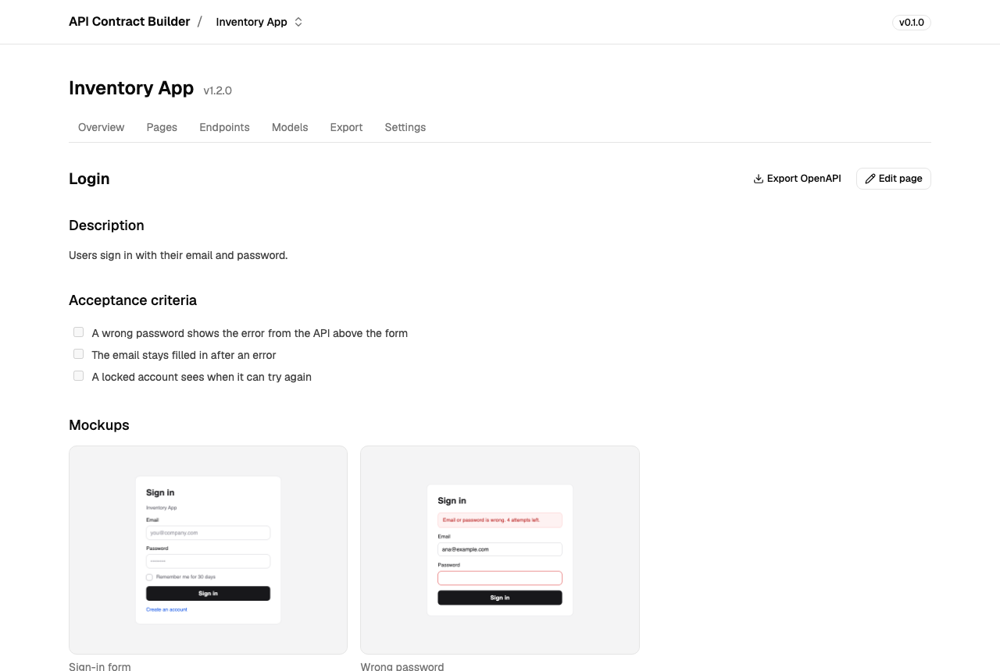
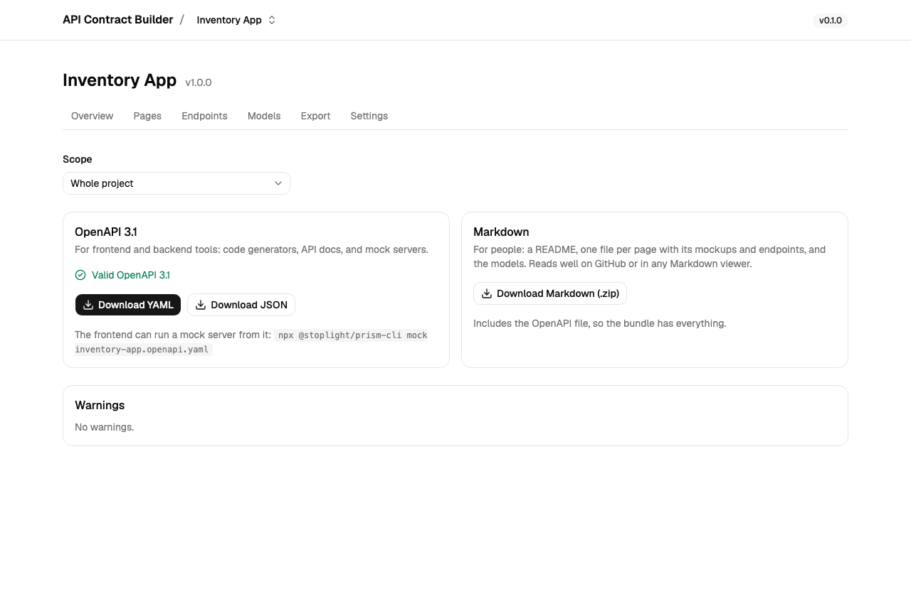
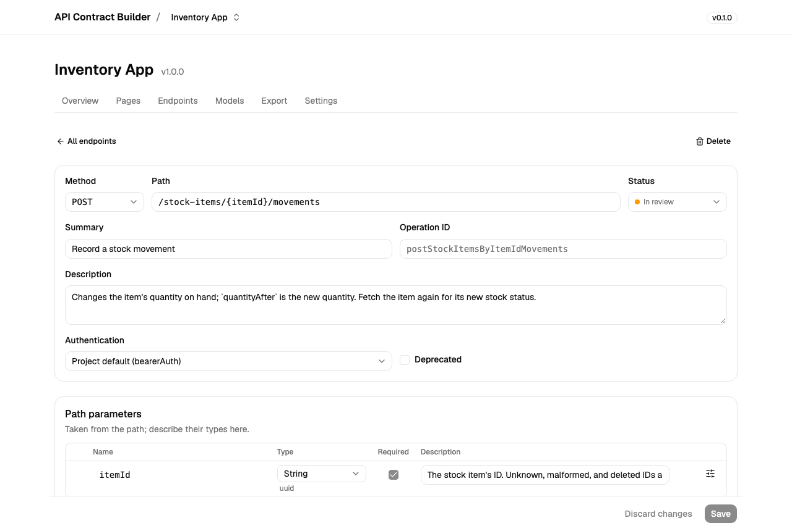

# API Contract Builder

[](https://github.com/reggarantai/api-contract-builder/actions/workflows/ci.yml)
[](https://hub.docker.com/r/reggarantai/api-contract-builder)
[](LICENSE)

Write API contracts the way the product is discussed: **page by page**. For each screen,
describe what it does, attach its mockups, and list the endpoints it calls and when. Then
hand the contract over as **OpenAPI 3.1** for frontend and backend tools and as
**Markdown** for everyone else, so frontend and backend can build in parallel.



- **Pages**: description and acceptance criteria in Markdown, mockup images, and the
  endpoints the page calls, each with a trigger (on load, on submit, on an action).
- **Endpoints**: parameters, request bodies, responses per status code with their headers,
  named examples, authentication, a status (draft, in review, agreed), and notes for each
  side.
- **Models**: reusable schemas, edited with a field builder or as JSON Schema.
- **Export**: OpenAPI 3.1 (YAML or JSON) and a Markdown bundle (.zip), for the whole
  project or one page. Contracts are validated before export, and warnings point at
  missing examples and unused endpoints or models.

It runs locally, for one author, as a single Docker container. Data stays on your machine.

## Quick start

```bash
docker run -d --name api-contract-builder \
  -p 127.0.0.1:3000:3000 \
  -v api-contract-builder-data:/data \
  reggarantai/api-contract-builder:latest
```

The image runs on `linux/amd64` and `linux/arm64`, Apple silicon included. To build it
from this repository instead: `docker build -t api-contract-builder .`

Open <http://127.0.0.1:3000> and choose **Create sample project** to look around a
finished contract, or start your own with **New project**. The sample is an inventory app
with sign-in, registration, password reset, and stock pages, written the way a production
API would be: problem details for errors, paged lists, refresh tokens in a cookie, and
idempotent creates.

The port is published on `127.0.0.1` only, so the app is reachable from your machine and
nowhere else. With Docker Compose: `docker compose up -d`.

## Handing the contract over



The **Export** tab downloads the contract for the whole project or for one page.

**Frontend**

- Start a mock server from the OpenAPI file. It answers with the examples in the contract:

  ```bash
  npx @stoplight/prism-cli mock inventory-app.openapi.yaml
  curl -H "Authorization: Bearer x" http://127.0.0.1:4010/stock-items
  curl -H "Authorization: Bearer x" -H "Prefer: example=empty" http://127.0.0.1:4010/stock-items
  curl -X DELETE -H "Authorization: Bearer x" -H "Prefer: code=409" \
    http://127.0.0.1:4010/stock-items/1e3a5c7e-9b2d-4f6a-8c0e-3b5d7f9a1c2e
  ```

- Generate types or a client, for example with
  [openapi-typescript](https://openapi-ts.dev) or [Orval](https://orval.dev).

**Backend**

- Generate server stubs or types with [OpenAPI Generator](https://openapi-generator.tech),
  [oapi-codegen](https://github.com/oapi-codegen/oapi-codegen) (Go), or the tool of your
  stack.
- Check a running implementation against the contract with Prism's proxy, which reports
  every request and response that doesn't match:
  `npx @stoplight/prism-cli proxy inventory-app.openapi.yaml http://localhost:8080`.

**Everyone else**

The Markdown bundle has a README, one file per page with its mockups and endpoints, and
the models. It reads well on GitHub, GitLab, or any Markdown viewer, and includes the
OpenAPI file too.



## Data, backups, and upgrades

Everything (the SQLite database and uploaded mockups) lives in the `/data` volume, so it
survives restarts, upgrades, and removing the container.

**Back up** to `api-contract-builder-backup.tgz` in the current folder:

```bash
docker stop api-contract-builder
docker run --rm -v api-contract-builder-data:/data -v "$PWD":/backup alpine \
  tar czf /backup/api-contract-builder-backup.tgz -C /data .
docker start api-contract-builder
```

**Restore** a backup, replacing the current data:

```bash
docker stop api-contract-builder
docker run --rm -v api-contract-builder-data:/data -v "$PWD":/backup alpine \
  sh -c 'rm -rf /data/* && tar xzf /backup/api-contract-builder-backup.tgz -C /data'
docker start api-contract-builder
```

**Upgrade** by pulling the new image and starting a new container on the same volume.
Database migrations run on startup.

```bash
docker pull reggarantai/api-contract-builder:latest
docker rm -f api-contract-builder
docker run -d --name api-contract-builder \
  -p 127.0.0.1:3000:3000 \
  -v api-contract-builder-data:/data \
  reggarantai/api-contract-builder:latest
```

To stay on one minor version, use a tag like `0.1` instead of `latest`; each release is
also tagged with its full version, like `0.1.0`. `latest` and `0.1` also get the base
images' security fixes every week, while `0.1.0` stays exactly as released.
[CHANGELOG.md](CHANGELOG.md) lists what changed.

## Configuration

| Variable        | Default                           | Description                             |
| --------------- | --------------------------------- | --------------------------------------- |
| `HOST`          | `127.0.0.1` (`0.0.0.0` in Docker) | Interface the server listens on         |
| `PORT`          | `3000`                            | Port the server listens on              |
| `DATA_DIR`      | `./data` (`/data` in Docker)      | SQLite database and uploaded images     |
| `MAX_UPLOAD_MB` | `10`                              | Largest mockup image accepted, per file |

## Security

The app has no login, because it's meant for one person on their own machine: keep its
port on `127.0.0.1`. To report a vulnerability, see [SECURITY.md](SECURITY.md).

## Contributing

See [CONTRIBUTING.md](CONTRIBUTING.md) for the development setup, tests, and conventions,
and [docs/ARCHITECTURE.md](docs/ARCHITECTURE.md) for how it's built and why. Ideas for later
are [issues labeled enhancement](https://github.com/reggarantai/api-contract-builder/issues?q=label%3Aenhancement).

## License

[MIT](LICENSE) © Regga
